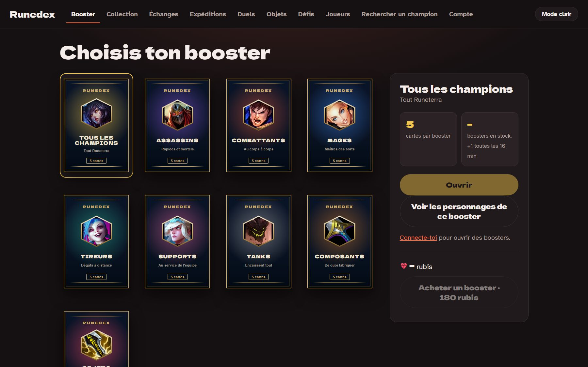

# Runedex

Jeu de collection de cartes League of Legends en PHP et JavaScript. C'est mon projet final de 1re année à l'IIM (sous le nom « LOL c'est bien »), reconstruit en novembre 2026.



## Fonctionnalités

- **Boosters** : un paquet par classe de champion, un booster ajouté au stock toutes les 10 minutes, ouverture ×1 / ×5 / ×10 avec animation. 1 booster sur 100 est holographique et donne 50 cartes.
- **Collection** : album avec taux de complétion, favoris, doublons et skins.
- **Rubis** : on recycle ses doublons pour acheter des boosters. Récompense quotidienne.
- **Échanges** de cartes entre joueurs.
- **Expéditions** : on envoie un champion sur la carte de Runeterra pour gagner des rubis, des objets et des skins.
- **Objets et duels** : on fabrique des objets, puis on affronte 10 paliers de bots avec les vraies stats du jeu.
- **Défis** et **classement** des joueurs.
- Comptes avec mots de passe hachés, et un mode clair / sombre.

Le tirage, le stock et les échanges sont vérifiés côté serveur, donc on ne peut pas tricher depuis le navigateur.

## Technologies

HTML, CSS, JavaScript, PHP 8, SQLite (PDO). Les données des champions et des objets viennent de [Data Dragon](https://developer.riotgames.com/docs/lol#data-dragon), l'API publique de Riot Games.

## Lancer le projet

Il faut PHP 8 avec l'extension `pdo_sqlite`.

```bash
php -S localhost:8000
```

Ouvre ensuite http://localhost:8000/booster.html et crée un compte depuis la page Compte. La base de données `booster-lol-donnees.sqlite` est créée automatiquement dans le dossier parent, en dehors du site.

---

Runedex n'est pas approuvé par Riot Games et ne reflète pas les opinions de Riot Games ni de quiconque officiellement impliqué dans la production ou la gestion de League of Legends. League of Legends et Riot Games sont des marques déposées de Riot Games, Inc.
